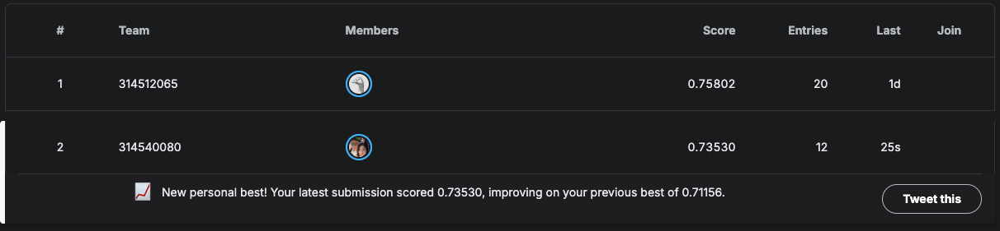

# NYCU LLM Homework 1

## Overview

Problem 1 identifies the language of a text (English, French, Spanish, Portuguese, German) with character-level
bigram, trigram, RNN and LSTM language models. Problem 2 scores the semantic similarity of patent phrases with a
Transformer encoder written from scratch and submits the predictions to the course Kaggle competition.

## Highlights

- RNN and LSTM cells written from scratch and checked against `nn.RNN` and `nn.LSTM` in `tests/`.
- Multi-head attention and the encoder layer written from scratch, no pretrained weights or external data.
- Problem 2 ensemble of 24 regressors with RE2 alignment blocks and a MatchPyramid interaction branch, plus
  character-level and anchor neighbour features built from `train.csv` only.

## Installation

```bash
conda create -n llm-hw1 python=3.11
conda activate llm-hw1
pip install -r requirements.txt
```

## Dataset Preparation

```
data/
├── problem1/   train.csv, val.csv, test.csv
└── problem2/   train.csv, val.csv, test.csv, sample_submission.csv
```

## Training

| Task | Command | Output |
|---|---|---|
| Problem 1 | `bash scripts/p1_language_id.sh` | `outputs/<date>_p1_language_id/` |
| Problem 2 ensemble and submission | `bash scripts/p2_ensemble_submission.sh` | `outputs/<date>_p2_v15/submission.csv` |
| Problem 2 (c) head comparison | `bash scripts/p2_head_comparison.sh` | `outputs/<date>_p2_head_comparison/` |
| Tests | `python -m pytest tests` | |

Each script fixes its GPU with `CUDA_VISIBLE_DEVICES`, so edit the number in the script to change it. Extra arguments
are forwarded to `main.py`, for example `bash scripts/p2_ensemble_submission.sh --seeds 42` for a 12-model run.

## Results

### Problem 1: language identification (test set, 700 texts)

RNN and LSTM are trained for 40 epochs, keeping the checkpoint with the lowest validation perplexity for each language.

| Model | Accuracy | Macro-F1 | Val PPL | Test PPL | Train / build time | Peak memory | Inference time |
|---|---|---|---|---|---|---|---|
| Bigram | 0.9729 | 0.9727 | 11.44 | 11.33 | 1.1 s (CPU) | 0.5 MB | 0.81 s |
| Trigram | **0.9871** | **0.9871** | 9.70 | 9.40 | 0.9 s (CPU) | 2.9 MB | 0.78 s |
| RNN | 0.9857 | 0.9857 | 4.62 | **4.42** | 1155 s (GPU) | 190 MB | 1.36 s |
| LSTM | 0.9843 | 0.9842 | 5.10 | 4.91 | 3470 s (GPU) | 632 MB | 3.21 s |

### Problem 2: semantic similarity (Kaggle)

| Model | Val Pearson | Val RMSE | Kaggle public |
|---|---|---|---|
| Main model, 4 heads, mean pooling | 0.4547 | 0.2427 | |
| Ensemble of 24 (12 configurations, 2 seeds) | **0.7251** | **0.1779** | **0.73530** |



## Submission

The two notebooks in `src/notebooks/` are self-contained and are the files to submit as `hw1_314540080.zip`.

## Acknowledgements

- [Attention Is All You Need](https://arxiv.org/abs/1706.03762), Vaswani et al., NeurIPS 2017, for the encoder.
- [Simple and Effective Text Matching with Richer Alignment Features](https://arxiv.org/abs/1908.00300), Yang et al.,
  ACL 2019, for the RE2 alignment blocks.
- [Text Matching as Image Recognition](https://arxiv.org/abs/1602.06359), Pang et al., AAAI 2016, for the MatchPyramid
  branch.
